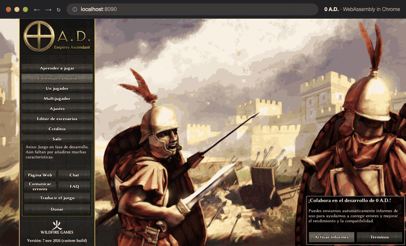

  

Real capture of the WebAssembly build in Chrome: main menu → skirmish setup → match against the Petra AI. The browser frame was added when making the GIF; everything inside it is the game.

# 0ad-web

**0 A.D. in the browser.** An unofficial port of the open-source real-time strategy game
[0 A.D.](https://play0ad.com) (release 0.28.0, engine *pyrogenesis*) to WebAssembly with Emscripten.
It is a port, not a rewrite: the original C++ engine, its JavaScript simulation and the Petra AI
run in the page, with a set of patches that make them work on the web platform.

It runs in desktop **Chrome** and **Firefox**. **Safari** is not supported yet: it lacks
JavaScript Promise Integration (JSPI), which the port relies on.

## Highlights

- **SpiderMonkey compiled to WebAssembly.** The game's JavaScript engine (SpiderMonkey 128, no JIT)
  is itself built to wasm and runs the game simulation and the AI scripts inside the page.
- **Deterministic.** The wasm build reproduces the native reference replay hash
  (`6908836f8d8ca50562faab971ad0c4ca`) in a headless Node run, so the simulation stays in lockstep
  with the native game.
- **WebGL2 renderer.** The GL backend runs on WebGL2 with shaders on GLSL ES 3.00, including shadows.
- **Streams the game data.** The 0 A.D. archive is not downloaded up front: the engine reads files
  over HTTP Range requests in 64 KiB blocks (JSPI suspends the engine only on a cache miss), and the
  blocks are kept in a persistent Cache Storage cache, so a second visit loads mostly from disk.
  Textures are served at medium resolution by default to keep a match download small.
- **Petra AI in a Web Worker.** The AI runs off the main thread and talks to the simulation through
  `SharedArrayBuffer` + `Atomics`, so AI computation does not block rendering on the main thread.
- **User data persists** (configuration and other user files) through IDBFS, and a licenses page
  ships with the build.

## Status

Measured on an Apple-silicon Mac with a real GPU, in desktop Chrome:

| What | Result |
|------|--------|
| 4-player skirmish, 1920×1080 | ~60 fps (most 10 s samples 57–60 fps) |
| 60-minute observer match, 4 Petra AIs | no crash; wasm memory peaks at ~1.2 GB and stays flat |
| Engine start → main menu (50 Mbit/s link) | ~5 s |
| Start → match ready (50 Mbit/s link) | ~31 s on first play |
| Firefox 159, skirmish at 1280×720 | ~60 fps, slightly more frame-time jitter than Chrome |

Known limitations:

- **Safari** has no JSPI, so the page shows an "unsupported browser" message. Supporting it is a
  separate project.
- **No JIT** in the wasm SpiderMonkey: rare event-heavy simulation turns (for example one script
  changing the owner of many entities) can take several hundred milliseconds late in a match.
- **Multiplayer and the lobby** are not ported yet (a WebSocket transport for ENet is designed).
- **Saved games** are not supported with the worker-hosted AI yet.
- **No public hosting yet.** The build needs a server that sends COOP/COEP headers
  (`SharedArrayBuffer` requires cross-origin isolation).

## How it works / repo layout

| Path | What it holds |
|------|---------------|
| `patches/upstream/` | Numbered patches applied to the 0 A.D. 0.28.0 source: wasm toolchain, Emscripten platform layer, WebGL2 backend fixes, remote file reads, AI worker, and more. |
| `tools/wasm/` | Build scripts (`build-engine.sh`), the browser runtime glue (`web-lib.js`, `web-env.pre.js`), the AI worker, archive tools (map settings index, deflated archive) and the licenses page. |
| `tools/web/` | Browser drivers used for testing: `chrome-shot.mjs` and `firefox-shot.mjs` control a headless browser over its remote protocol (screenshots, input, fps, page probes). |
| `tools/bench/`, `tools/spikes/` | Profiling helpers and small experiments, including the static server with COOP/COEP headers. |
| `wasm/` | SpiderMonkey-to-wasm build inputs, stubs and third-party library builds. |
| `runbooks/` | Step-by-step instructions for each task of the port. |
| `reports/` | What each task found and measured. |
| `odd/` | The project plan and logbook (specs, task table, decisions). |
| `fixtures/` | The reference replay used to check determinism against the native build. |

The upstream source checkout (`upstream/`, tag v0.28.0), the game data from the official release
and build outputs are not stored in this repository.

## Credits and licensing

0 A.D. is made by [Wildfire Games](https://wildfiregames.com) and contributors. Its code is
licensed under **GPL-2.0-or-later** and its art and other assets under **CC-BY-SA 3.0**; the
full list of third-party licenses ships with the build (`tools/wasm/web/licenses/`).

This is an **unofficial** port. It is not affiliated with or endorsed by Wildfire Games.
"0 A.D." and "Wildfire Games" are names of the original project, used here only to say what this
port runs.
